  

  

  
  
  

 

<h2 align="center">📚 STACKS</h2>

  
  
  
   
  
  
  
  
   
  
  
  
  
  
   
  
  
  
  
  
   
  
  
  
  
  
   
  
  
  
   
  
  
  
  

 

<h3>Proyectos destacados</h3>

  
  
  
  

